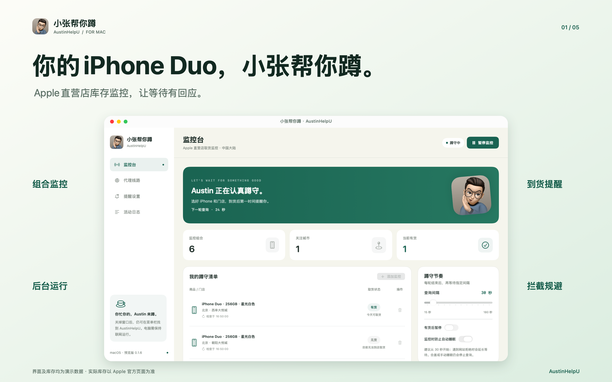
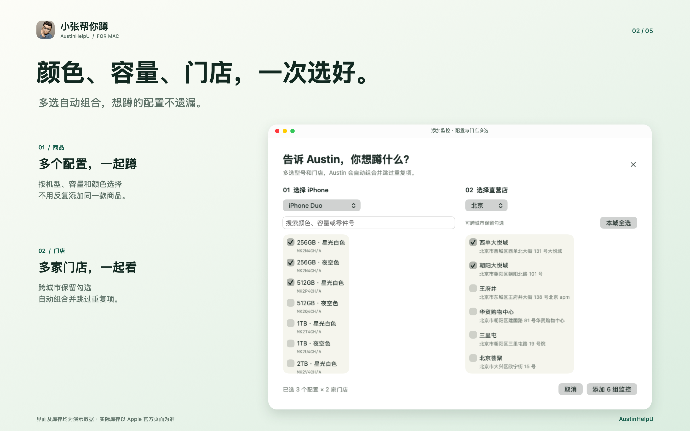
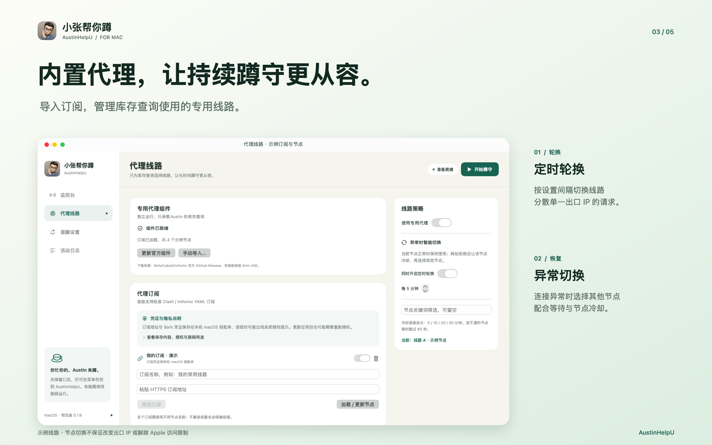
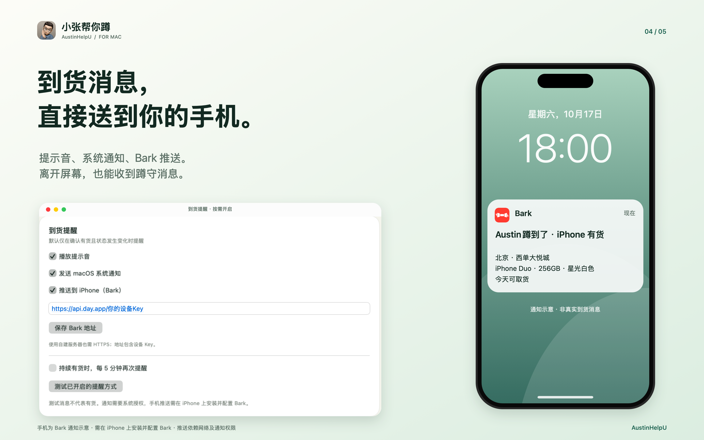
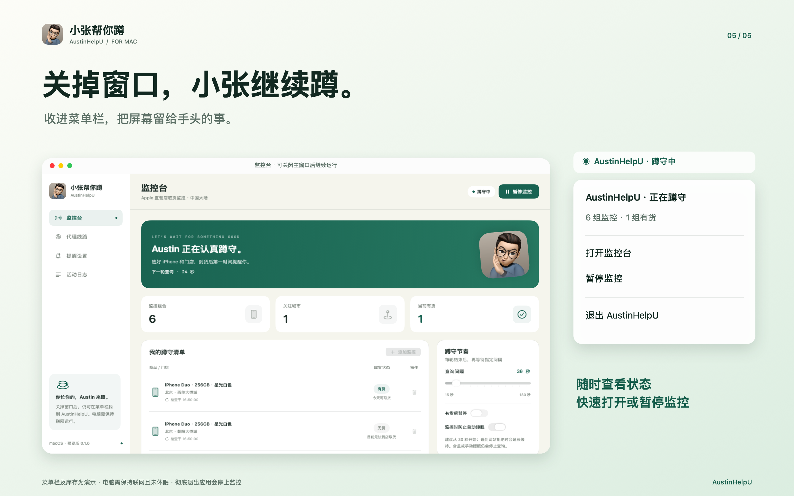

# 小张帮你蹲 · AustinHelpU

**你的 iPhone Duo，小张帮你蹲。**

一款基于 SwiftUI 开发的原生 macOS 应用，用于监控中国大陆 Apple 直营店的 iPhone 到店取货状态。选好机型、容量、颜色和门店，让小张替你定时查看，并在发现有货时发送提醒。

[下载预览版](https://github.com/joyzas/AustinHelpU/releases) · [详细使用说明](docs/USAGE.md)



## 主要功能

- **组合监控**：多选商品配置与直营店，自动生成组合并去重。
- **定时查询**：支持开始、暂停及调整查询间隔，显示库存状态、取货日期和最近检查时间。
- **刷新反馈**：每次结果返回后短暂高亮，即使库存没有变化也能看到更新。
- **到货提醒**：支持提示音、macOS 系统通知和 Bark 手机推送，可设置有货后暂停。
- **内置代理与节点轮换**：支持导入 Clash / mihomo 订阅，通过专用代理和节点轮换，分散单一出口 IP 的请求，降低持续监控触发访问频率限制的概率。实际效果取决于节点出口及 Apple 的限制策略。
- **后台运行**：关闭主窗口后继续在菜单栏蹲守，可快速打开或暂停监控。
- **本机配置与日志**：保存监控清单和设置，支持查看及导出运行日志。

## 运行要求

- Apple 芯片 Mac（M1 及更新机型），macOS 14 或更高版本。
- 库存查询需安装 Google Chrome 或 Microsoft Edge，并放在系统的“应用程序”目录。
- 使用代理功能需在应用内下载或手动导入 mihomo 组件，不预置订阅或代理节点。

## 开始使用

1. 从 [Releases](https://github.com/joyzas/AustinHelpU/releases) 下载并解压，将 AustinHelpU.app 拖入“应用程序”。
2. 添加需要监控的商品配置和直营店。
3. 按需配置代理订阅与提醒方式，再点击“开始蹲守”。
4. 首次使用也可点击“看看演示效果”了解布局；演示数据不代表真实库存，不会发送到货提醒。

预览版采用本地临时签名，尚未经过 Apple Developer ID 签名与公证；请核实下载来源后，按 macOS 的正常提示处理。

## 功能展示

### 多个配置、多家门店，一起蹲



### 内置代理与线路切换



### 到货消息，送到手机



手机外观、Bark 通知及库存状态为演示内容，不是实时到货消息。手机需安装并配置 Bark，推送依赖网络及通知权限。

### 收进菜单栏，继续蹲守



电脑需保持联网且未休眠。关闭窗口后可继续监控；彻底退出、关机、合盖或睡眠会中断查询。

## 隐私与凭证

本仓库和安装包不包含任何用户的订阅地址、节点配置、监控清单、日志或推送凭证，均由用户自行配置。

- 订阅地址、Bark 服务器地址及设备 Key 保存在本机 macOS 钥匙串。读取时可能出现系统授权提示，更新应用后也可能需要重新授权；`cn.xiaozhang.watch` 是本应用保存凭证的标识。
- 应用仅按自己的标识读取保存的凭证，不查询其他应用的密码。拒绝授权可能影响相关订阅加载或 Bark 推送。不要在应用的订阅输入框中填写 Mac 登录密码。
- 监控清单与普通设置保存在本机。为运行代理，节点连接凭证还会写入仅当前用户可读写的本机代理配置文件，并非所有凭证都只存在于钥匙串。
- 加载订阅会访问用户配置的订阅服务；启用 Bark 后，商品、门店及提醒内容会发送到用户配置的推送服务器。库存请求通过所选网络或代理访问 Apple。凭证不会上传给本软件开发者。

## 当前范围与限制

当前版本为 **0.1.7 预览版**。仅支持中国大陆 iPhone 到店取货监控，不包含自动加购、辅助结账、下单或付款。

查询结果表示是否可以到店取货，不代表剩余台数。库存随时可能变化，以 Apple 官方购买页面为准。商品、门店目录为静态快照，暂不自动更新。

查询失败显示“未确认”，不能当作“无货”。遇到 HTTP 403、429 或 541 时会停止当轮查询；代理模式下冷却当前节点并尝试切换，网站拒绝后至少等待 60 秒再开始下一轮。节点切换不保证改变出口 IP，也不保证解除网站限制。

0.1.7 修复：所有可选节点都冷却时保持监控运行，等待最早到期的节点，重新测速并按循环顺序选择；若测速仍失败则继续等待。暂停会取消等待。节点被筛选或排除到没有候选项时，仍会提示用户检查设置。

已完成 Mac 构建、签名检查、12 项核心逻辑测试和 9 项节点轮换回归测试；维护者已实机确认本次修复可用，不同网络、长期运行和推送送达仍需用户按实际环境验证。

## 从源码构建

安装 macOS Command Line Tools 后，在项目根目录运行：

```bash
bash build.command
```

应用输出至 `Build/AustinHelpU.app`，构建目标为 macOS 14+ arm64。无需 Node.js、Rust 或第三方 Swift 包。

```bash
bash test.command            # 核心逻辑测试
bash test.command --browser  # 可选：独立浏览器连接检查，不请求 Apple
bash package.command         # 打包应用与源码，输出至上一级 deliverables 目录
```

## 致谢与许可

- 查询流程、状态分类和线路管理设计参考 [suversal/apple-store-inventory-monitor](https://github.com/suversal/apple-store-inventory-monitor)，中国大陆商品和门店目录由其数据转换。
- 代理功能使用 [MetaCubeX/mihomo](https://github.com/MetaCubeX/mihomo)，组件由用户独立下载，遵循其自身许可。
- 人物图标由本项目维护者提供；宣传图中的 Bark 图标用于说明其推送功能。

本项目按 **GPL-3.0-or-later** 提供。来源、上游归属与修改说明见 [LICENSE](LICENSE)、[NOTICE](NOTICE) 和 [THIRD_PARTY.md](THIRD_PARTY.md)。

本项目与 Apple Inc. 无关联或授权关系。
